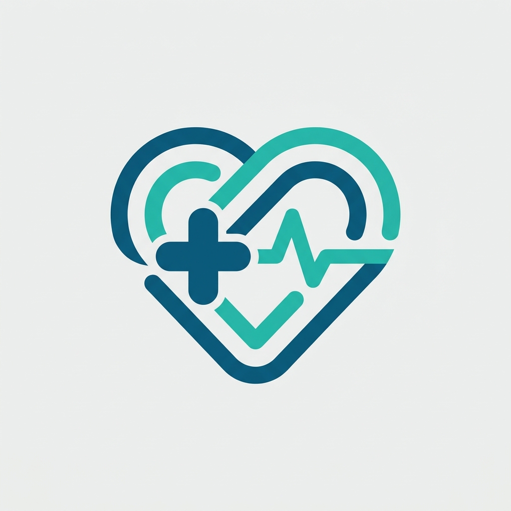
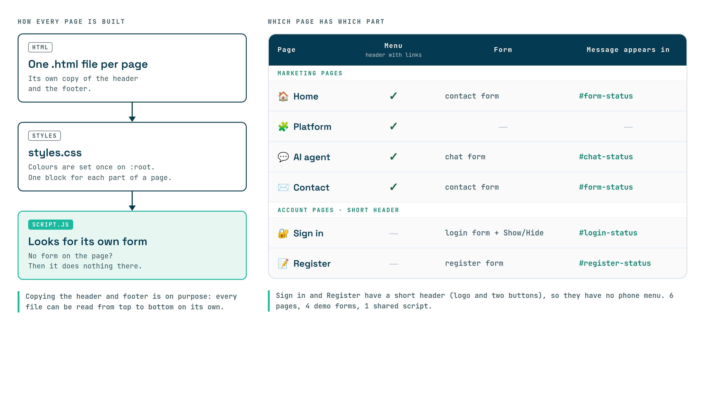
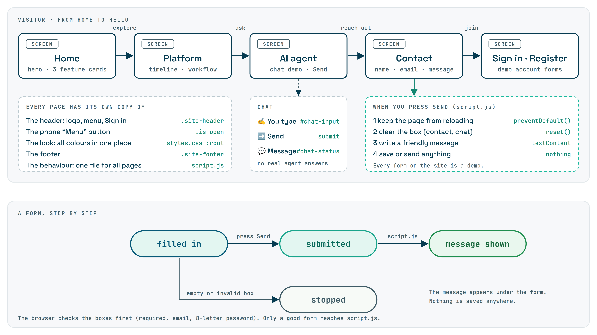
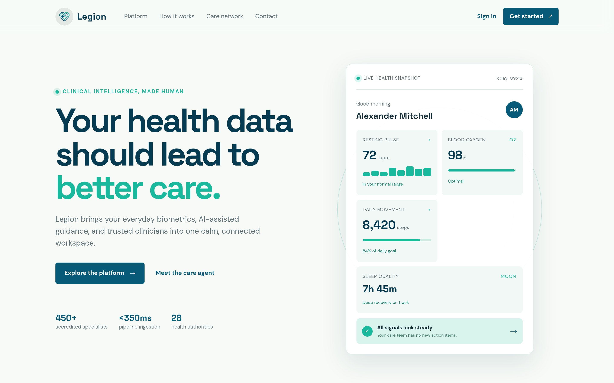
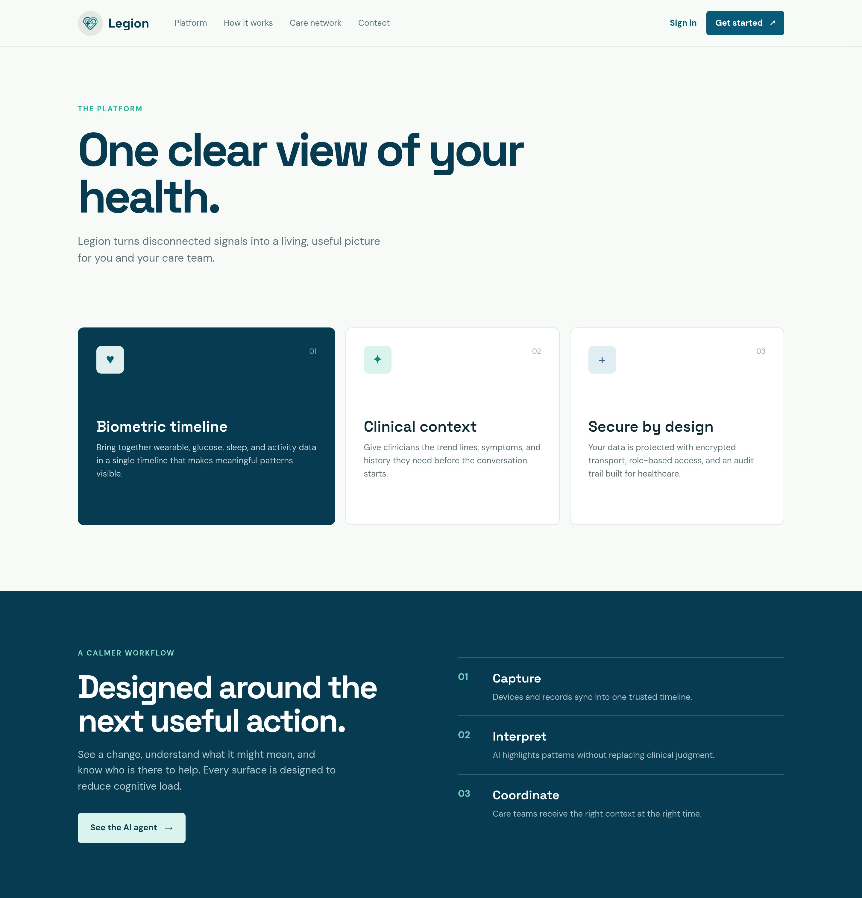
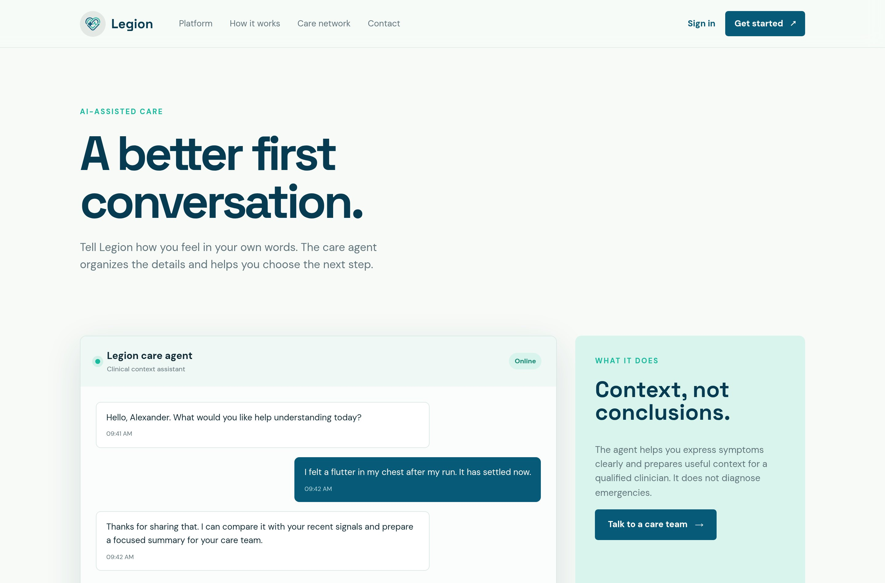
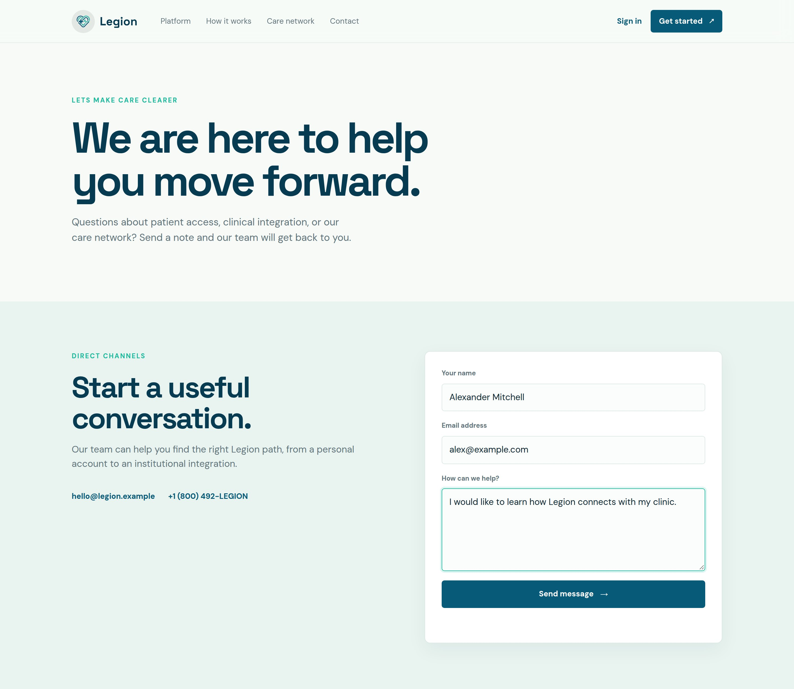
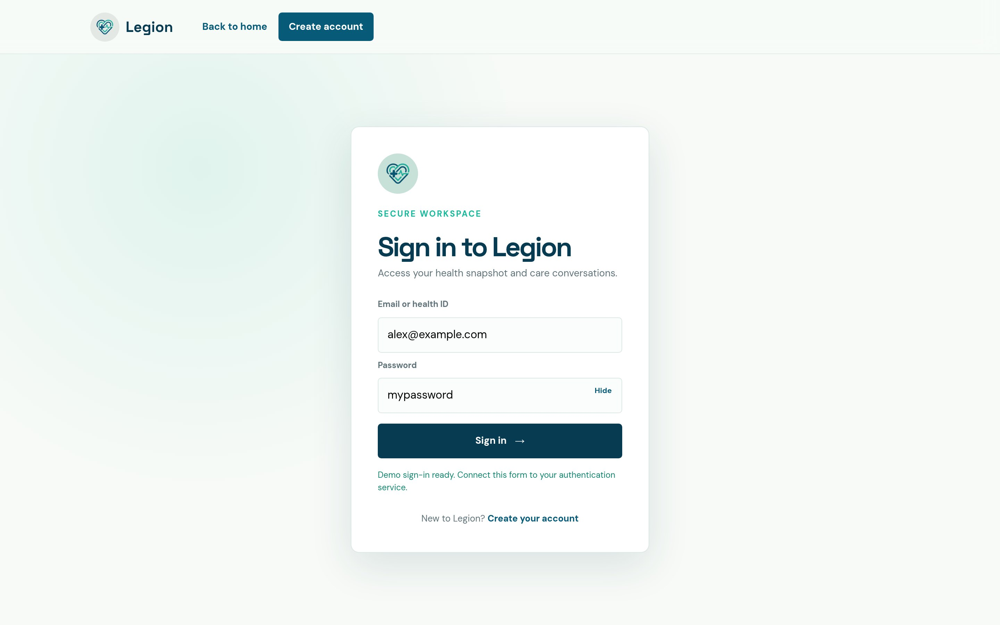
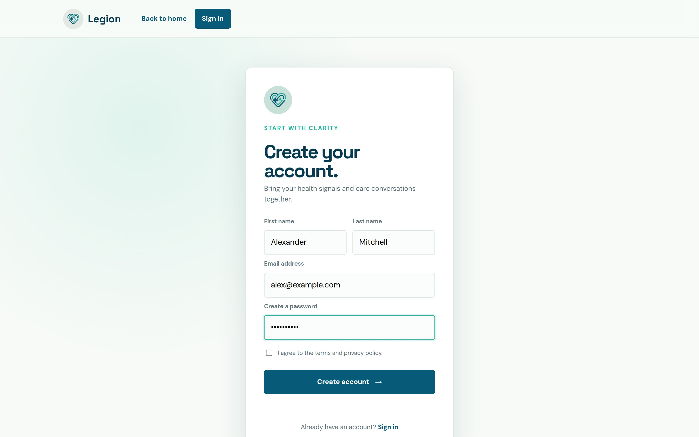
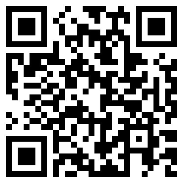

# Legion: Health-tech website

Project documentation for the Legion website, 2026. By Omar Mofreh (Malek).

<p align="center"></p>

> **How to use this document:** every yellow <mark>✏️</mark> box is yours to fill in. Everything else was taken from the code. When you are done, run `python docs/build.py` to rebuild the PDF, the poster and the slides.

## 1. Project Overview | نظرة عامة على المشروع

| Field | Value |
|-------|-------|
| **Project Title** | Legion: Health-tech website |
| **Project Type** | Static website (no database, no server code) |
| **Description** | Legion is a website for a made-up health-tech company. Visitors can read about the platform, try a demo of the AI care agent chat, send a message to the team, and open sign-in and register forms. |
| **Target Users** | Patients who want a clear view of their health data, and the clinicians and care teams who look after them. |
| **Live site** | <https://omar-mofreh.github.io/legion/> |

### Tech Stack | التقنيات المستخدمة

| Category | Technology | Purpose |
|----------|-----------|---------|
| Structure | HTML | Six pages, each in its own `.html` file |
| Styling | CSS | One file, `styles.css`, with the colours set once on `:root` |
| Behaviour | JavaScript | One file, `script.js`: the phone menu, the Show/Hide password button and the demo form messages |
| Fonts | Google Fonts | DM Sans and Space Grotesk, loaded by a link in each page |

### Dependencies | المكتبات

There is nothing to install. The site uses no framework and no package manager. The only outside file is the Google Fonts stylesheet.

## 2. Problem Statement | المشكلة

Health data is scattered across devices and records, so patients cannot see the whole picture and clinicians start visits without context. Legion shows one connected picture.

### Why does it matter? | لماذا هذا مهم؟

Patients are left to explain symptoms from memory, and care teams miss trends that could help them act sooner.

### How is it currently solved? | كيف تُحل المشكلة حاليًا؟

People use separate apps, wearables and paper records. Each one shows only a piece, and none of them prepares a short summary for the clinician.

## 3. Technical Architecture | البنية التقنية

### Project Structure | هيكل المشروع

```text
legion/
├── index.html        # Home: hero, health dashboard card, feature cards, steps, contact form
├── platform.html     # Platform: three feature cards, workflow, care network numbers
├── ai-agent.html     # AI care agent: a chat demo
├── contact.html      # Contact form
├── login.html        # Sign-in form
├── register.html     # Create-account form
├── styles.css        # All the styling
├── script.js         # All the behaviour, shared by every page
├── assets/logo.png   # The logo
└── docs/             # This documentation, the poster, the slides and the diagrams
```

### How it works | كيف يعمل

Every page loads `styles.css` and `script.js`. Each page has its own copy of the header and the footer, on purpose, so every file can be read on its own. `script.js` looks for a form by its id. If the page has no such form, it does nothing.



### Key Files | الملفات الأساسية

| File | Purpose |
|------|---------|
| `index.html` | The home page, with the live-health-snapshot card, three feature cards, the three steps and a contact form. |
| `styles.css` | All the colours, layout and the two phone/tablet rules at the end (850px and 620px). |
| `script.js` | The phone menu, the Show/Hide password button, and the message each demo form shows when you send it. |

## 4. Features & User Flow | المميزات ورحلة المستخدم

### Feature List | قائمة المميزات

| # | Feature | Description | Status |
|---|---------|-------------|:------:|
| 1 | Home page | Headline, a health dashboard card (pulse, oxygen, steps, sleep), three feature cards and three steps. | Complete |
| 2 | Platform page | A timeline, a calm workflow and care-network numbers. | Complete |
| 3 | AI care agent | A chat panel. Typing a message shows a "message received" note. | Demo only |
| 4 | Contact form | Name, email and message, with a thank-you note. | Demo only |
| 5 | Sign in and Register | Forms with a Show/Hide password button. | Demo only |
| 6 | Phone menu | A "Menu" button opens the links on small screens. | Complete |

### User Flow | رحلة المستخدم



### Screen Reference | الشاشات

| Screen | File | Description |
|--------|------|-------------|
| Home | `index.html` | The first page: what Legion is, with a sample dashboard. |
| Platform | `platform.html` | What the platform does and who is in the care network. |
| AI agent | `ai-agent.html` | A chat demo with a short explanation of what the agent does. |
| Contact | `contact.html` | The contact form and the email and phone. |
| Sign in | `login.html` | Email and password form. |
| Register | `register.html` | First name, last name, email, password and a terms checkbox. |

## 5. UI/UX Design | تصميم واجهة المستخدم

### Screenshots | لقطات الشاشة

| Home | Platform |
|------|----------|
|  |  |

| AI agent | Contact |
|----------|---------|
|  |  |

| Sign in | Register |
|---------|----------|
|  |  |

Try the site: <https://omar-mofreh.github.io/legion/>



### Design System | نظام التصميم

| Element | Current implementation |
|---------|------------------------|
| Logo | A heart made of lines, with a plus sign and a heartbeat, in deep blue and teal (`assets/logo.png`). |
| Main colour | Deep blue `#075A78` for buttons, and `#063B51` for the dark sections |
| Accent colour | Mint `#19B99D` for small labels and highlights |
| Background | Soft cream `#F7FAF7` |
| Fonts | Space Grotesk for headlines, DM Sans for text |
| Layout | Content is at most 1180px wide. Cards sit in a grid that becomes one column on a phone. |

## 6. Data Sources | مصادر البيانات

There is no database and no outside data. The numbers on the dashboard card and the care-network numbers are examples written straight into the HTML. The forms do not save or send anything.

### External APIs | الخدمات الخارجية

None. The site only loads two Google Fonts.

### Limits | حدود المشروع

These shortcuts were taken on purpose to keep the code simple. The full list is in the README.

- The forms are pretend. They save nothing and send nothing.
- The AI care agent is not real. The chat only shows a "message received" note.
- The health numbers and the patient name are made-up examples.
- No passwords are checked, because there are no accounts.
- The header and footer are copied into each page, so a change means editing six files.

## 7. Educational Content | المحتوى التعليمي

### Learning Objectives | أهداف التعلم

Through building this project, a student can practice:

1. Writing a page with clear sections: header, main content and footer.
2. Using grids, one set of colour variables and two @media rules so the site fits tablets and phones.
3. Using one small script that looks for a form by its id and shows a friendly message.
4. Turning the menu into a Menu button on small screens.
5. Keeping code simple enough that every file can be read on its own.

### Curriculum Alignment | الارتباط بالمنهج

| Skill Area | What the Student Practices |
|------------|---------------------------|
| Problem Solving | Finding a simple way to show a health platform without a backend. |
| Computational Thinking | Breaking the site into pages, shared styles and one shared script. |
| Creativity | Designing a calm look and a sample health dashboard from the logo's colours. |
| Collaboration | Built by Omar Mofreh with the Malek team. |
| Technical Writing | Writing the README, its Limits section and this documentation. |

## 8. Marketing Plan | خطة تسويقية

- **Primary audience:** Patients who track their own health.
- **Secondary audience:** Clinicians, hospitals and clinics that want connected care.
- **Where people will use it:** Phone and desktop browsers.
- **Where it is shared:** The live site on GitHub Pages, with the QR code on the poster and slides.

## 9. Student Worksheet | ورقة عمل الطالب

**Student Name:** Omar Mofreh  
**Project Title:** Legion: Health-tech website

### What is your project about? | عن ماذا يتحدث مشروعك؟

Legion is a website for a health-tech company. It shows how health signals, an AI care agent and care teams can work together.

### What problem does it solve? | ما المشكلة التي يحلها؟

Health data is scattered, so patients and clinicians do not see one clear picture. The site shows how Legion would fix that.

### What I Learned | ماذا تعلمت

1. **The hardest part:** Making the layout work on tablets and phones.
2. **The most fun part:** Building the sample health dashboard card.
3. **If I had more time:** Connect the forms to a real service.

### Screenshot of My Project | لقطة من مشروعي


---

Omar Mofreh · Malek · 2026
